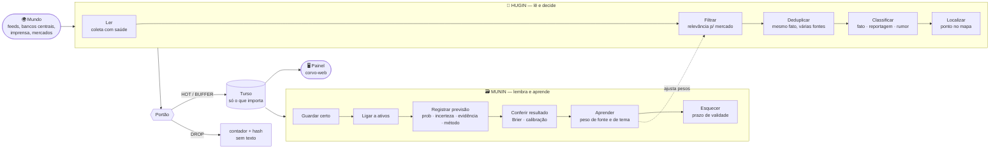
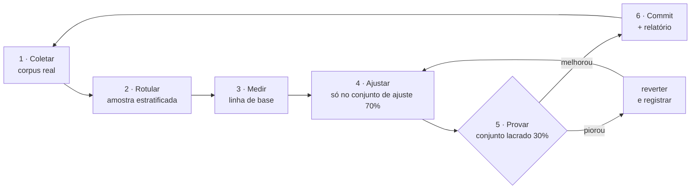
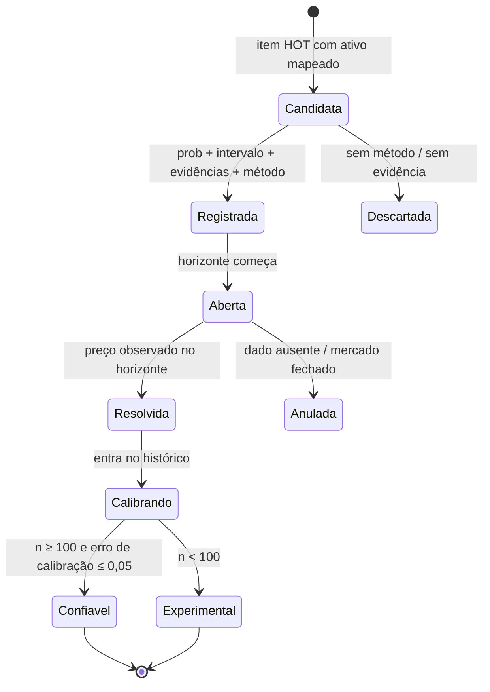

<div align="center">

# HUGIN & MUNIN
### Guia de treino dos dois corvos do CORVO

**Hugin** lê o mundo e decide o que importa. **Munin** lembra, confere e aprende.
Este documento diz **o que significa "certo"** para cada um, **como medir** e **como treinar**.

`para o agente Codex` · `ordem de serviço: CODEX_BRIEF_COLETA.md` · `regras de git, segredos e fontes: valem as de lá`

</div>

> [!IMPORTANT]
> **Treinar aqui não é treinar rede neural.** Hugin é um portão **determinístico** (termos, pesos, limiares) e Munin é uma **memória com contas honestas** (registro, conferência, calibração). "Treinar" = **medir erros em dados reais, ajustar regras e provar a melhora em dados lacrados**. Nada de LLM decidindo em produção, nada de probabilidade inventada.

---

## 0. Painel de controle

| | 🧠 **HUGIN** (pensamento) | 🗃️ **MUNIN** (memória) |
|---|---|---|
| **Pergunta que responde** | "Isto pode mexer em mercado?" | "O que aconteceu depois, e quanto confiar?" |
| **Faz** | lê, filtra, classifica, localiza | guarda, esquece, registra previsões, confere, calibra |
| **Roda** | a cada 10 min (coleta) | a cada previsão e a cada resultado |
| **Estado hoje** | **no ar** (24 feeds, portão v3) | **bancada de prova pronta** (`corvo_engine/munin`, 18 testes); previsão real ainda não publicada |
| **Esta noite** | **medir e ajustar com dados** (principal) | **usar e ampliar a bancada**; propor M3 e M6 |
| **Métrica-rainha** | precisão do HOT e recall do keep | erro de calibração e Brier contra a taxa-base |
| **Pior erro** | perder o que mexe em preço | prometer certeza que não tem |

```
   NOITE DE TRABALHO           ████████████████████░░░░░░░░   Hugin  ~70% do tempo
                               ████████░░░░░░░░░░░░░░░░░░░░   Munin  ~30% do tempo
```

---

## 1. A ideia, em um desenho

Na mitologia nórdica, Odin envia Hugin (pensamento) e Munin (memória) todo dia para sobrevoar os nove reinos. Voltam ao amanhecer e contam o que viram. O CORVO faz o mesmo com notícias e sinais do mundo.



> [!NOTE]
> A seta pontilhada é o coração do projeto: **o que Munin aprende volta para Hugin** (fontes que acertam pesam mais; temas que não geram previsão certa pesam menos). Por enquanto essa seta é manual: você mede e o dono aprova.

---

## 2. O ciclo de treino (vale para os dois)



### As três regras de ouro
1. **Conjunto lacrado.** 30% dos rótulos, sorteados com semente fixa, **ninguém olha enquanto ajusta**. É o juiz. Melhora só no conjunto de ajuste **não conta**.
2. **Rotule pelo conteúdo**, nunca pela decisão do portão.
3. **Resultado ruim vai para o relatório.** Se piorou, reverta e escreva o que aprendeu.

---

# 🧠 PARTE I — HUGIN

> **Missão:** gravar **só o que pode mexer em mercado** (cripto, ações, câmbio, juros, commodities, e o risco geopolítico ou físico que chega a eles). Na dúvida sobre algo **sem efeito plausível em preço**, **descarte**.

## 3. Hugin em cinco habilidades

| # | Habilidade | "Certo" significa | Onde vive | Meta |
|---|---|---|---|---|
| **H1** | 📡 **Ler** | todo feed lido, nenhuma falha derruba o ciclo, ninguém é martelado | `collect/` | 0 ciclos quebrados; 0 feeds com 403/429 ativos |
| **H2** | 🎯 **Filtrar** | entra o que mexe em preço; sai o resto | `intake/gate.py` | precisão HOT ≥ 0,85 · recall keep ≥ 0,90 |
| **H3** | 🔁 **Deduplicar** | mesmo fato de 6 fontes vira 1 linha, sem fundir fatos diferentes | `intake/gate.py` | fusões erradas ≤ 2% |
| **H4** | 🏷️ **Classificar** | fato só de fonte oficial; na dúvida, reportagem | `oracle/publisher.py` | 0 rumor/opinião como fato; acerto ≥ 0,80 |
| **H5** | 📍 **Localizar** | ponto certo no mapa, sem inventar lugar | `intake/geo.py` | cobertura ≥ 85% · acerto ≥ 95% |

### 3.1 Termômetro de Hugin (medido hoje, corpus de 07/11, 24 feeds)

```
 lidas ........ 818  ████████████████████████████████████████
 irrelevantes .. 666  ██████████████████████████████████░░░░░░   81%
 velhas ........  71  ████░░░░░░░░░░░░░░░░░░░░░░░░░░░░░░░░░░░░    9%   (relevantes que envelheceram)
 abaixo corte ..  29  ██░░░░░░░░░░░░░░░░░░░░░░░░░░░░░░░░░░░░░░    4%
 gravadas ......  52  ███░░░░░░░░░░░░░░░░░░░░░░░░░░░░░░░░░░░░░    6%   32 HOT · 20 BUFFER
```

### 3.2 Auditoria do que já foi para o banco (T0, feita em 2026-11-08)

> Esta tabela é a **auditoria inicial** (portão v2). Depois dela foi feito um **pré-ajuste (v3)**; os resultados dele estão logo abaixo.

| Rótulo | Qtde | % | Leitura |
|---|---|---|---|
| ✅ **keep** (mexe em preço) | 18 | **35%** | Irã/Golfo, tarifas, juros BoE/BoJ, MEXC, ETFs, Binance |
| 🟡 **marginal** | 30 | 58% | conflito periférico, fala de banco central, política |
| ❌ **drop** (não devia entrar) | 4 | 8% | protesto de fazendeiros, mercado em Taiz, navio no Ártico |

> [!WARNING]
> **Meta é ≥ 85% de keep entre as gravadas.** A auditoria inicial deu **35%**. Causas: (1) `conflito_chave` dava 0,90 para qualquer ataque no Iêmen ou na Ucrânia; (2) falas de banco central com nome de pessoa davam 0,98 (HOT); (3) `politica` e `empresas` deixavam passar notícia regional sem efeito em preço.

#### Pré-ajuste v3 (já feito antes da sua noite)
Corrigidas as três causas: conflito **regional** (Rússia, Ucrânia, Iêmen, Israel, Síria...) pesa 0,50 e **não grava sozinho**; conflito em **região-chave** (Irã, Hormuz, Golfo, Mar Vermelho, Taiwan, Mar do Sul da China) segue 0,95; banco central separado em **decisão** (1,0), **contexto** (0,7), **fala** (0,45, não grava) e **troca de comando** (0,9); `impeachment` e balanço de empresa pesam menos; tema só no resumo vale 50% e nunca chega ao banco.

| Nas mesmas 52 auditadas | Antes | Depois |
|---|---|---|
| ✅ keep que continuam aceitas | 18 de 18 | **18 de 18** (nenhum perdido) |
| 🟡 marginal aceitas | 30 | **11** |
| ❌ drop aceitos | 4 | **0** |
| **Keep entre as aceitas** | **35%** | **62%** |

> [!CAUTION]
> **Este 62% é otimista**: o ajuste foi feito **olhando esses mesmos 52 itens**. A prova de verdade é no **conjunto lacrado** da sua amostra. Ainda faltam 23 pontos para a meta de 85%: os 11 marginais restantes (banco do Paraguai, balanços, "S&P exposto à IA", troca de comando de banco central) mostram onde a régua ainda é frouxa.

### 3.3 Modos de falha de Hugin (use como lista de caça)

| Falha | Exemplo real | Por que importa | Como caçar |
|---|---|---|---|
| **Falso positivo de conflito** | "Yemen: 30 dead in strikes on Taiz market" | enche o banco de guerra sem efeito em preço | rotular 100 itens com "strikes"; separar região-chave de periférica |
| **Fala vira decisão** | "Christine Lagarde: Interview with Yomiuri" = 0,98 | HOT para o que é marginal | separar **decisão** (taxa, ata, comunicado) de **fala** |
| **Palavra solta** | "gold" de karatê, "troops" de rotina | lixo que parece mercado | contraexemplos em testes (já há 8; amplie) |
| **Rotina regulatória** | "approval of application by Peoples Bancorp" | Fed e BoE publicam dezenas por mês | lista de ruído por padrão de título |
| **Perda por idade** | "Bank rate increased to 4%" já saiu como `stale` | o pior erro: perder o que importava | olhar o motivo `stale` só entre relevantes (já separado) |
| **Quase-duplicata** | ataque em Qeshm em 5 fontes | linhas repetidas | medir Jaccard em pares reais |
| **Lugar errado** | incêndio local aparecendo em "Israel/Gaza" | ponto falso no mapa | auditar `region` em amostra de 100 |
| **Idioma** | espanhol, francês, árabe passam menos | cegueira para América Latina e África | léxico ES e FR + medir recall por idioma |

### 3.4 Como treinar cada habilidade

<details>
<summary><b>H2 — Filtrar (a mais importante)</b></summary>

1. Gere o corpus (`--dry-run --dump`) e a amostra: `py benchmarks\corvo_make_sample.py data\corvo_corpus\corpus.jsonl --n 300`. Ela traz **todos os aceitos** (precisão) e uma **amostra dos rejeitados** (recall), com peso `w`.
2. Rotule cada item como `keep | marginal | drop` olhando **só o título** (rubrica na seção 3.5).
3. Meça a linha de base (`corvo_gate_eval.py`, que você vai criar, seção 7).
4. Ajuste `TOPICS`, `_NOISE`, pesos e cortes **olhando só o conjunto de ajuste**.
5. Rode no conjunto lacrado **uma vez por rodada de ajuste** e registre.

Alavancas, da mais barata à mais cara:
- `_NOISE`: padrão de título que nunca é mercado (rotina, humanitário, esporte).
- Pesos de `TOPICS`: ex. `conflito_chave` de 0,95 para região-chave de verdade e 0,50 para o resto.
- Separar **decisão** de **fala** em `banco_central`.
- Cortes `GateConfig.hot_min` / `buffer_min`.
- Léxico novo (ES, FR) com contraexemplos.
</details>

<details>
<summary><b>H3 — Deduplicar</b></summary>

Pares reais: o mesmo fato em 3 a 6 fontes. Construa **pares rotulados** (mesmo fato / fatos diferentes) a partir do corpus. Teste normalização de título (acento, caixa, stopwords, aspas) e limiares de Jaccard. **Fusão errada é pior que deixar passar uma cópia**: reporte as duas taxas.
</details>

<details>
<summary><b>H4 — Classificar</b></summary>

`classify_kind` é por regras. Meça contra os rótulos de `kind`. Regra de ouro: **na dúvida, reportagem**; só `official` vira fato. O teste decisivo: **zero rumor ou opinião marcados como fato**.
</details>

<details>
<summary><b>H5 — Localizar</b></summary>

Cobertura (aprovados com `region`) e **acerto** (amostra auditada). Cuidado com ambiguidade: *Georgia*, *Jordan*, *Turkey*, *Chad*, nomes de empresas. Falso positivo é pior que falta de ponto: **sem correspondência, não aparece no mapa**.
</details>

<details>
<summary><b>H1 — Ler</b></summary>

Feed que devolve HTML, trava, muda de formato ou dá 5xx **não derruba o ciclo** e é registrado por fonte. Teste com respostas ruins. Ficha por fonte: itens/dia, % irrelevante, % velho, % duplicata, % aprovado, **quem publica primeiro**. Recomende `reliability` e quem desativar (a ONU é quase toda humanitária; o G1 geral rende pouco).
</details>

### 3.5 Rubrica de rotulagem (cole na sua cabeça)

```
 ┌─ keep ──────────────────────────────────────────────────────────────┐
 │ efeito PLAUSÍVEL em preço de ativo ou em risco que chega a ele       │
 │  · decisão de juros, ata do FOMC, comunicado de banco central        │
 │  · dado de inflação, emprego, PIB                                    │
 │  · tarifa, sanção, embargo, controle de exportação                   │
 │  · corte/aumento de produção de petróleo; Hormuz, Mar Vermelho       │
 │  · terremoto/furacão em polo industrial; ataque a energia/porto      │
 │  · hack/ruína de exchange; ação de OFAC/SEC/CFTC em cripto           │
 │  · falência, calote, rebaixamento relevante; queda abrupta de bolsa  │
 ├─ marginal ──────────────────────────────────────────────────────────┤
 │ efeito indireto, lento ou incerto (conta como "não gravar" no HOT)   │
 │  · crise política que pode derrubar governo                          │
 │  · fala de dirigente sem decisão; pesquisa eleitoral                 │
 │  · conflito periférico sem rota de energia                           │
 ├─ drop ──────────────────────────────────────────────────────────────┤
 │ sem efeito previsível em preço                                       │
 │  · celebridade, esporte, receita, opinião, publieditorial            │
 │  · crime comum, incêndio/obra local, ajuda humanitária               │
 │  · rotina de regulador (aprovação de aplicação, ata técnica)         │
 │  · "previsão de preço" de blogueiro, "como fazer"                    │
 └─────────────────────────────────────────────────────────────────────┘
```

---

# 🗃️ PARTE II — MUNIN

> **Missão:** guardar só o que merece, **esquecer no prazo**, registrar cada previsão **antes** do resultado e **conferir depois**, para saber em que tipo de previsão o CORVO acerta e em qual não.

> [!CAUTION]
> **Honestidade sobre o estado.** Nenhuma previsão é publicada em produção e a tabela de previsões está vazia. O corpus tem horas ou dias, não meses. Portanto, **não existe aprendizado estatístico possível esta noite**. O que **já existe** é a **bancada de prova** em `engine/corvo_engine/munin/` (contas, registro validado, retenção, anti-vazamento) e a ferramenta `benchmarks/corvo_munin_eval.py`, ambas testadas (18 testes) com dados sintéticos. O seu trabalho é **usar, endurecer e ampliar** a bancada, e **propor** M3 e M6. Inventar acerto com amostra pequena é o erro que este guia existe para evitar.

## 4. Munin em seis habilidades

| # | Habilidade | "Certo" significa | Estado | Entrega esta noite |
|---|---|---|---|---|
| **M1** | 🗄️ **Guardar certo** | só HOT/BUFFER; **nunca** o texto de um DROP; só título, link e resumo curto | ✅ no ar | ✅ **invariante testado** (`munin/retention.py`); amplie |
| **M2** | 🧹 **Esquecer certo** | notícia 30 dias, estatística 14 dias, hash 48 h | ✅ no ar | ✅ **prazos conferidos contra o Worker** em teste |
| **M3** | 🔗 **Ligar a ativos** | cada item aprovado aponta para ativos plausíveis, com direção e horizonte | ❌ `assets` vai vazio | **tabela tema → ativos** proposta e testada |
| **M4** | 📝 **Registrar previsão** | probabilidade, intervalo, evidências, **método**; nunca sem método | 🟡 tabela existe, API recusa o inválido | ✅ **validador** (`munin/registry.py`) casado com a API |
| **M5** | ⚖️ **Conferir** | resultado contra o preço real, sem olhar o futuro | 🟡 contas prontas, sem dados reais | ✅ **bancada** (`munin/scoring.py`, `leakage.py`); falta alimentá-la com resultados reais |
| **M6** | 🎓 **Aprender** | peso de fonte e de tema a partir de resultado, com amostra mínima | ❌ | **proposta** + regra de "sem dados suficientes" |

### 4.1 O ciclo de vida de uma previsão



> [!TIP]
> Duas regras que o produto já impõe e que a bancada precisa **provar por teste**: previsão **sem método não entra**; e a **probabilidade precisa estar dentro do intervalo de incerteza** (a API já recusa o contrário, `corvo.ts`). Até 100 previsões resolvidas, tudo é **EXPERIMENTAL**.

### 4.2 M5 — a bancada de prova (o centro do trabalho de Munin)

Já existe: `engine/corvo_engine/munin/` e `engine/benchmarks/corvo_munin_eval.py` (`--synthetic` mostra um previsor calibrado contra um exagerado: ECE 0,014 contra 0,211). Ela calcula, sobre uma lista de `(previsão, resultado)`:

| Medida | Fórmula / ideia | Para que serve |
|---|---|---|
| **Brier** | média de `(p − y)²` | erro da probabilidade |
| **Brier da taxa-base** | prever sempre a frequência histórica | **a régua**: se não bate isto, o modelo não vale |
| **Skill** | `1 − Brier / Brier_base` | ganho sobre a régua (≤ 0 = inútil) |
| **ECE** | erro de calibração por faixas de `p` | "quando digo 70%, acontece 70%?" |
| **Cobertura do intervalo** | % de resultados dentro de `[lo, hi]` | incerteza honesta |
| **Taxa de abstenção** | % de casos em que o CORVO diz "não sei" | **dizer "não sei" é resposta válida** |
| **Vazamento** | teste que **falha** se alguma feature usa dado depois do corte | impede olhar o futuro |

```
   confiança declarada ──►  0.1  0.3  0.5  0.7  0.9
   frequência real    ──►  0.1  0.3  0.5  0.7  0.9     ← calibrado = diagonal
                           ·    ·    ·    ·    ·
```

**Dados de preço (somente leitura, quando for o caso):** séries públicas de cripto (candles da Binance, o MNEME já coleta) e referência de câmbio do BCE. **Registre antes** em `docs/sources/SOURCES.md` (acesso, termos, limite, retenção) e guarde só local. Sem registro, use apenas dados sintéticos.

### 4.3 M3 — ligar notícia a ativo (proposta, não contrato)

Comece com uma **tabela editável e auditável** (nada de LLM):

| Tema | Ativos candidatos | Direção típica | Horizonte |
|---|---|---|---|
| `banco_central` (corte) | USD, BTC, ouro, índices | USD ↓ · BTC ↑ · ouro ↑ | 24 h |
| `energia` (corte OPEP) | petróleo, moedas de exportadores | petróleo ↑ | 24 h |
| `conflito_chave` (Golfo) | petróleo, ouro | volátil ↑ | 6 h a 3 d |
| `cripto` (hack de exchange) | token afetado, BTC | ↓ | 6 h |
| `comercio` (tarifa) | pares afetados, câmbio | volátil | 24 h |

> [!WARNING]
> A direção é **hipótese**, não fato. Ela só vira peso depois que Munin medir, com amostra mínima, que a hipótese se sustenta. Sem amostra: **`INSUFFICIENT_DATA`**.

### 4.4 M6 — aprender sem se enganar

- **Amostra mínima:** nenhum peso muda com menos de **30 resolvidos por tema ou fonte**.
- **Múltiplos testes:** com muitos temas, algum "acerta" por sorte. Use correção (Bonferroni ou Benjamini-Hochberg) e reporte quantas hipóteses foram testadas.
- **Janela de ajuste x janela de prova:** ajuste no passado, prove no futuro (divisão **temporal**, nunca embaralhada).
- **Reversível:** todo ajuste versionado e com como desfazer (cabe no relatório como proposta).

---

## 5. Placar final (o que sobe e o que prova)

### 🧠 Hugin

| Métrica | Hoje | Meta | Conjunto |
|---|---|---|---|
| Keep entre as gravadas (T0) | **35%** (v2) · **62%** (v3, otimista) | ≥ 85% | auditoria do feed |
| Precisão do HOT | a medir | ≥ 0,85 | lacrado |
| Recall do keep | a medir | ≥ 0,90 | lacrado |
| HOT entre os aceitos | ~79% (70 de 89, só relevância) | ≤ 25% | corpus |
| Fusões erradas (dedup) | a medir | ≤ 2% | pares rotulados |
| Rumor/opinião como fato | a medir | **0** | rotulado |
| Cobertura do mapa | a medir | ≥ 85% | aprovados |
| Acerto do local | a medir | ≥ 95% | amostra |
| Linhas de banco por dia | ~100 (projeção) | ≤ 5 mil · ≤ 25 mil com 5× volume | simulação |

### 🗃️ Munin

| Métrica | Hoje | Meta | Conjunto |
|---|---|---|---|
| Texto de DROP guardado | 0 | **0 (testado)** | invariante |
| Retenção cumprida | 30/14/48 conferidos | 100% (testado) | sintético |
| Registro com os 4 campos | API **e** `munin/registry.py` | 100% (testado) | sintético |
| Vazamento temporal | `munin/leakage.py` testado | **falha se existir** | sintético |
| Skill sobre a taxa-base | calculável (+0,35 no simulado calibrado) | só com dados reais ≥ 100 | sintético |
| ECE | calculável (0,014 no simulado calibrado) | ≤ 0,05 com ≥ 100 resolvidas | sintético |

---

## 6. A noite, hora a hora

```mermaid
gantt
    title Noite de treino (6 a 8 h)
    dateFormat  HH:mm
    axisFormat  %H:%M
    section Em segundo plano
    Coleta do corpus (1 ciclo a cada 10 min)      :active, c1, 00:00, 6h
    section Hugin
    Fase 0 · preparar e conferir feeds            :h0, 00:00, 15m
    T0 · auditar o que já está no banco           :h1, after h0, 20m
    Rotular amostra (≥ 300, lacre 30%)            :h2, after h1, 60m
    Linha de base (corvo_gate_eval.py)            :h3, after h2, 45m
    Ajustar H2 e H3 (filtro e dedup)              :h4, after h3, 90m
    Ajustar H5, H4, H1 (mapa, tipo, fontes)       :h5, after h4, 60m
    section Munin
    Rodar e endurecer a bancada (M1 a M5)         :m1, after h3, 45m
    Alimentar M5 com cenários realistas           :m2, after m1, 60m
    Proposta M3 e M6                              :m3, after m2, 30m
    section Entrega
    Relatório e commits                           :r1, after h5, 30m
```



---

## 7. Ferramentas que já existem e as que você cria

| Arquivo | Estado | Uso |
|---|---|---|
| `python -m corvo_engine.collect --dry-run --dump` | ✅ | coleta e registra **cada** decisão |
| `engine/benchmarks/corvo_review.py` | ✅ | lista aceitas e rejeitadas de um corpus (só relevância) |
| `engine/benchmarks/corvo_make_sample.py` | ✅ | monta a amostra estratificada com lacre 70/30 e pesos |
| `engine/benchmarks/corvo_gate_eval.py` | 🔨 **você cria** | matriz `label × verdict`, precisão/recall **ponderados por `w`**, por conjunto |
| `engine/benchmarks/corvo_munin_eval.py` | ✅ | Brier, taxa-base, skill, ECE, cobertura (`--synthetic` ou arquivo de resolvidas) |
| `engine/corvo_engine/munin/` | ✅ | `scoring`, `registry`, `leakage`, `retention`; 18 testes em `tests/test_munin.py` |
| `engine/tests/…` | 🔨 | **amplie**: pares de dedup, contraexemplos de léxico e de geo (M1/M2 já têm testes) |

> [!NOTE]
> **Ponderação.** A amostra tem **todos os aceitos** (peso 1) e **parte dos rejeitados** (peso `w` = total de rejeitados ÷ amostrados). Recall e taxa de keep descartado devem usar esses pesos, senão superestimam o erro dos rejeitados.

**Comandos de partida** (PowerShell, pasta `engine`):
```powershell
py -m corvo_engine.collect --once --dry-run --quiet --dump data\corvo_corpus\corpus.jsonl
py benchmarks\corvo_make_sample.py data\corvo_corpus\corpus.jsonl --n 300 --seed 20261108
py benchmarks\corvo_review.py data\corvo_corpus\corpus.jsonl --rejected --limit 300
```

---

## 8. Esqueleto do relatório (copie para `docs/corvo/RELATORIO_NOITE_<data>.md`)

```markdown
# Relatório da noite — <data>

## 1. Resumo para o dono (10 linhas)
## 2. Hugin
| Métrica | Linha de base (ajuste / lacrado) | Depois (ajuste / lacrado) | Meta |
### Mudanças (uma por linha, com commit)
### O que piorou ou foi revertido
### 10 exemplos que o portão ainda erra (título · motivo)
### Fichas das fontes
### Auditoria do banco (T0)
## 3. Munin
### Invariantes testados (M1, M2)
### Bancada de prova (M4, M5): como rodar e o que ela mostra com dados sintéticos
### Propostas (M3, M6) para aprovação
## 4. Fontes novas sugeridas (ligadas ou não)
## 5. Perguntas para o dono
## 6. Próximos passos
```

---

## 9. Limites que não se negociam

| 🚫 Nunca | ✅ Sempre |
|---|---|
| deploy, `wrangler`, `gh secret`, escrever na API de produção | trabalhar **local**, em `--dry-run`, na branch `hen` |
| ler ou imprimir tokens, `.env`, chave do git-crypt | `sh scripts/gitcrypt_check.sh` antes de commitar |
| mudar contrato (lote, tabelas), editar `apps/worker`, `database`, workflows | **propor** no relatório |
| raspar HTML, burlar limite, login ou captcha | só RSS/Atom e APIs oficiais, 1 leitura/5 min por feed |
| guardar corpo de matéria, pessoas ou rostos | título, link e resumo curto, com atribuição |
| inventar rótulo, acerto ou previsão | dizer **"dados insuficientes"** |
| `git add -A`, `push --force`, merge na `main`, branch nova | commits pequenos, `git add` por nome, trava do quadro |

---

## 10. Glossário

| Termo | Significado |
|---|---|
| **HOT / BUFFER / DROP** | grava com relevância alta · grava com relevância média · não grava (vira só contador e hash) |
| **keep / marginal / drop** | rótulo humano: mexe em preço · efeito indireto · sem efeito |
| **Corpus** | arquivo local com **cada** item lido e a decisão tomada |
| **Lacre** | 30% dos rótulos que ninguém olha durante o ajuste |
| **Taxa-base** | frequência histórica de um evento; a régua mínima de qualquer previsão |
| **Brier** | erro quadrático médio da probabilidade (0 = perfeito) |
| **ECE** | erro de calibração: distância entre confiança declarada e frequência real |
| **Skill** | ganho do modelo sobre a taxa-base |
| **Vazamento** | usar, ao prever, informação que só existiria depois |
| **Âncora / ponto de observação** | lugar onde decisões acontecem (para sensores indiretos futuros) |

<div align="center">

*Hugin traz o que viu. Munin lembra se estava certo.*

</div>
