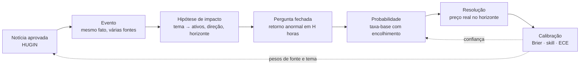

# Como Hugin e Munin viram o preditivo

> **Resumo.** Hoje o CORVO lê e filtra (Hugin). Para prever, falta uma cadeia de cinco etapas em que Hugin entrega **eventos limpos** e Munin os transforma em **perguntas com resposta verificável**, estima uma probabilidade honesta, confere o resultado e ajusta a confiança. Nada disso depende de modelo grande: começa pela **frequência histórica** e só ganha complexidade se **provar** no conjunto lacrado que bate essa régua.

## 1. O que "prever" significa aqui

Uma previsão do CORVO é uma **pergunta fechada com horizonte e resposta objetiva**, nunca uma opinião:

> "Depois do evento **E** (corte de juros do banco central X), o ativo **A** (BTC) terá retorno **acima de +1,0 desvio-padrão** nas próximas **24 h**?" → probabilidade **0,41** (intervalo 0,27 a 0,57) · 6 evidências em 4 fontes · método *taxa-base por tema e ativo, beta-binomial v1* · estado **calibrando**.

Quatro regras do produto (já impostas pela API): **probabilidade, intervalo, evidências e método** sempre juntos; probabilidade **dentro** do intervalo; sem método ou sem evidência, **não entra**; até 100 resolvidas, tudo é **experimental**.

## 2. A cadeia, do dado à previsão

| # | Etapa | Quem | Entrada → saída | Estado |
|---|---|---|---|---|
| 1 | **Lê e filtra** | Hugin | feeds → notícias que mexem em mercado | ✅ pronto |
| 2 | **Junta em eventos** | Hugin | várias notícias do mesmo fato → **um** evento com número de fontes independentes e nível de confirmação | ⬜ planejado |
| 3 | **Levanta hipóteses** | Munin | evento → ativos candidatos, direção, horizonte (tabela auditável) | 🟡 tabela proposta em `munin/impact.py` |
| 4 | **Prevê pela taxa-base** | Munin | pergunta fechada → probabilidade, intervalo, evidências, método | 🟡 `munin/baseline.py` (testado, sem dados reais) |
| 5 | **Confere e calibra** | Munin | previsão + preço real → acerto, erro contra a taxa-base, estado | 🟡 `munin/scoring.py` (testado, sem dados reais) |

## 3. Por que começar pela taxa-base (e não por um modelo)

A **taxa-base** é a frequência com que algo aconteceu antes: "depois de um corte de juros, o BTC subiu mais de 1 desvio-padrão em 24 h em 41% das vezes". É a **régua mínima**: um modelo que não a bate não vale nada. Ela tem três vantagens para o CORVO de hoje:
1. **Funciona com pouco dado** e diz exatamente quanto sabe (o intervalo é largo no começo).
2. **Dizer "não sei" é natural:** abaixo de 30 casos, o CORVO **se abstém** (`dados insuficientes`) em vez de inventar.
3. **É auditável:** qualquer pessoa refaz a conta.

**Como a probabilidade é calculada (v1).** Para cada chave *(tema, ativo, horizonte)* guarda-se quantas vezes a resposta foi "sim" e "não". A estimativa é a média de uma distribuição beta com *prior* fraco (1, 1): `p = (sim + 1) / (sim + não + 2)`. O intervalo central de 80% usa aproximação normal da posterior Beta, não quantis Beta exatos; sua cobertura ainda precisa ser validada com dados. Ele encolhe com mais dados. O código está em `engine/corvo_engine/munin/baseline.py`.

**Quando passar da taxa-base a um modelo.** Só se uma versão com características (relevância, número de fontes, hora do dia, regime de volatilidade, "surpresa" contra o consenso) **bater a taxa-base no conjunto lacrado, dividido no tempo**, com Brier menor e calibração aceitável. Primeiro candidato: regressão logística regularizada, simples e explicável. Redes ou ensembles só depois, e só se ganharem do simples.

## 4. O que precisa existir para isso funcionar

### 4.1 Eventos (Hugin, etapa 2)
Seis noticias sobre o mesmo fato sao **uma amostra, nao seis**: contar todas inflaria a confianca. O ID estavel do evento fica ancorado na primeira publicacao/URL para preservar identidade. Para prever, porem, o instante disponivel (`available_at`) e o maior `cycle_at` entre as materias agrupadas: e quando todas as fontes usadas na confirmacao ja eram conhecidas localmente. Ordene o walk-forward e inicie o horizonte de preco nesse instante. Se faltar `cycle_at` em qualquer materia do grupo, exclua e conte o evento sem adivinhar pela publicacao. A agrupacao usa a mesma ideia da quase-duplicata, com medida de erro propria (fusao errada e pior que copia solta).

### 4.2 Hipóteses de impacto (Munin, etapa 3)
Uma tabela **editável e auditável** (nada de modelo de linguagem decidindo): `banco central (decisão) → USD, BTC, ouro, índices`; `energia (corte de produção) → petróleo`; `conflito em região-chave → petróleo, ouro`; `cripto (hack de exchange) → token afetado, BTC`; `comércio (tarifa) → pares de câmbio afetados`. A **direção é hipótese**: só vira peso depois que Munin medir, com amostra mínima, que ela se sustenta. A proposta inicial está em `engine/corvo_engine/munin/impact.py`.

### 4.3 Preços (resolução, etapa 5)
Para conferir, é preciso o **preço real** no horizonte. Fonte pública e gratuita, a registrar antes em `docs/sources/SOURCES.md` (acesso, termos, limite, retenção): candles públicos de cripto e cotações de referência de câmbio. **Sem essa fonte registrada, nada é resolvido** e as previsões ficam abertas. Regras de resolução: janela contada a partir do horário do evento, retorno **anormal** (acima de k desvios da volatilidade recente, não acima de zero), mercado fechado = previsão anulada, nunca "não".

### 4.4 Quanto tempo leva ter amostra
Com ~50 notícias aprovadas por dia e ~10 temas, cada tema recebe poucos eventos por dia. Para **30 casos por (tema, ativo, horizonte)** são **semanas**, não horas. Por isso a primeira versão mira **poucos pares** (3 temas × 3 ativos × 2 horizontes) e deixa o resto em "dados insuficientes".

## 5. Como evitar enganar a si mesmo

| Armadilha | O que o CORVO faz |
|---|---|
| **Vazamento do futuro** | `munin/leakage.py`: só entra o que já era conhecido no instante da previsão; teste falha se algo posterior entrar |
| **Eventos correlacionados** | contar **eventos**, não notícias; um fato = uma amostra |
| **Muitos testes, alguém acerta por sorte** | correção de múltiplos testes (Bonferroni ou Benjamini-Hochberg) e registro de quantas hipóteses foram testadas |
| **Ajustar e provar nos mesmos dados** | ajuste no passado, prova no futuro (divisão **temporal**), conjunto lacrado |
| **Amostra pequena parecendo acerto** | nenhum peso muda com menos de 30 resolvidos; até 100, tudo é *experimental* |
| **Noticia que chega depois do movimento** | contar o horizonte de `cycle_at` (quando a coleta a conheceu) e medir separadamente o atraso frente a `published_at` |
| **Confiança inflada** | erro de calibração (ECE ≤ 0,05) e Brier contra a taxa-base antes de subir de estado |

## 6. Escada de maturidade do preditivo

| Nível | Nome | Critério | Estado |
|---|---|---|---|
| **P0** | Lê e filtra | portão calibrado, só o que mexe em mercado | ✅ |
| **P1** | Eventos | mesmo fato agrupado, com fontes independentes e confirmação | ⬜ |
| **P2** | Hipóteses testáveis | tabela tema → ativos, perguntas fechadas, regras de resolução | 🟡 |
| **P3** | Previsão pela taxa-base | probabilidade com intervalo, abstenção sem dados, registro validado | 🟡 (módulo pronto; falta dado) |
| **P4** | Conferida com preço real | resolução automática, Brier e skill contra a taxa-base | ⬜ precisa da fonte de preço |
| **P5** | Calibrada e confiável | ≥ 100 resolvidas, ECE ≤ 0,05, só então publica como confiável e ajusta pesos | ⬜ precisa de tempo |

> **Regra de subida:** um nível só conta com evidência numérica no conjunto lacrado e com o freio de banco verde.

## 7. O que o CORVO nunca faz com isso
Não envia ordens, não recomenda investimento, não publica previsão sem método e não apresenta previsão como fato. A saída é sempre **probabilidade com incerteza**, e a confiança vem do **histórico de acertos**, não da narrativa.

## 8. Próximos passos concretos
1. **P1:** agrupar notícias em eventos (`munin/events.py`), com identificador estável e contagem de fontes independentes; medir fusões erradas.
2. **P2:** revisar a tabela de hipóteses (`munin/impact.py`) com dados reais do corpus e escrever as regras de resolução.
3. **P4:** registrar uma fonte de preços em `docs/sources/SOURCES.md`, buscar o histórico local e rodar a resolução sobre os eventos já gravados.
4. **P3:** alimentar o modelo de taxa-base com os eventos resolvidos e publicar as primeiras previsões **como experimentais**.
5. Medir tudo na bancada (`engine/benchmarks/corvo_munin_eval.py`) e registrar no [diário de treino](TREINO_LOG.md).
