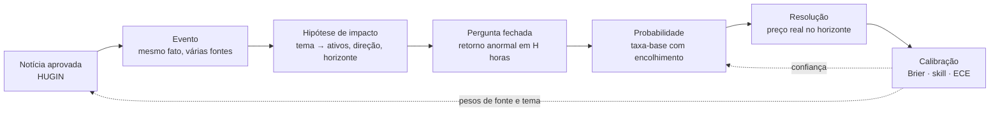

# Como Hugin e Munin viram o preditivo

> **Resumo.** O CORVO já tem caminhos preditivos em estados diferentes, mas ainda falta histórico real suficiente para demonstrar acerto. A cadeia de mercado Hugin→eventos→hipóteses→taxa-base→resolução está implementada como bancada local do Munin; ela ainda não publica previsões no Worker. O previsor público V1 continua sendo o nowcast de pulso/volume. Nada aqui depende de agente ou modelo grande: só se adiciona complexidade depois de superar a taxa-base em validação temporal.

Para o encaixe dentro do MNEME — campos que ele já consome, timestamps, persistência e limites do CORVO — consulte [INTEGRACAO_MNEME.md](INTEGRACAO_MNEME.md). A leitura confirmou que o MNEME já coleta RSS e gera atributos `n_*`; o próximo passo é enriquecer esse fluxo de forma aditiva, sem criar coletor concorrente.

## Onde cada preditor roda hoje

| Caminho | O que faz | Situação no fluxo |
|---|---|---|
| Forecast V1 (`forecast.py`, `forecast_surge.py`) | Nowcast do pulso do CORVO e do volume de sinais | Criado pelo `pipeline.py`, enviado ao Worker e exibido pela API conforme o contrato vigente; experimental até acumular resolução suficiente. |
| Forecast V2 (`forecast_v2.py`) | Compara o nowcast com pares históricos da mesma hora local | O `pipeline.py` pode anexar a previsão V2 à evidência V1 atrás de `FORECAST_V2_SHADOW`; a flag está OFF por padrão e não muda o que aparece ao usuário. |
| Forecast V2 de features (`forecast_v2_features.py`, `forecast_v2_model.py`) | Snapshot temporal e probabilidade heurística com cobertura, incerteza e abstenção | Módulos testados isoladamente no repo; a busca estática não encontrou chamada no `pipeline.py`. Ainda não alimenta Worker, painel ou V1. Bloqueio estático antes de integrar: o `fit_until` do calibrador é armazenado, mas não é comparado a `Snapshot.data_cutoff` no caminho de previsão. |
| Munin de mercado (`munin/`) | Agrupa notícias globais em eventos, cria hipóteses tema→ativo e resolve com preços locais | Acessado pelo benchmark `corvo_munin_backtest.py --dry-run`; registro local, sem chamada de produção. Falta cobertura de preços para várias hipóteses e histórico para calibrar. |

`forecast_v2.py` e `forecast_v2_model.py` são caminhos distintos apesar do nome parecido. A mudança de resolução `local-close-abnormal-return-v2` afeta somente o Munin de mercado; não altera V1 nem os dois módulos V2 de pulso.

### Saídas e contratos atuais

- O cartão “MUNIN · PREVISÕES” no painel lê `GET /api/corvo/feed`, que devolve a tabela `corvo_forecasts`. O coletor local do Munin ainda não envia registros para essa rota.
- O contrato compacto `corvo_forecasts` guarda pergunta, probabilidade, intervalo, contagem de evidências/fontes, método, horizonte e status. Não guarda desfecho, preço inicial/final, `event_id`, ativo, direção nem versão da regra; assim não basta para pontuar e reproduzir o backtest.
- `GET /api/forecasts` usa outra tabela e outro contrato, voltado a NOWCAST/EVENT/QUANTITY/OPEN, com resolução e Brier. Não tratar as duas tabelas como uma só nem encaixar a hipótese de mercado num `threshold` de nowcast sem definir semântica.
- A conexão de Munin à persistência precisa preservar o snapshot e a resolução verificável de cada hipótese. Até isso existir, o benchmark local é a única saída confiável do Munin de mercado.

## 1. O que "prever" significa aqui

Uma previsão do CORVO é uma **pergunta fechada com horizonte e resposta objetiva**, nunca uma opinião:

> "Depois do evento **E** (corte de juros do banco central X), o ativo **A** (BTC) terá retorno **acima de +1,0 desvio-padrão** nas próximas **24 h**?" → probabilidade **0,41** (intervalo 0,27 a 0,57) · 6 evidências em 4 fontes · método *taxa-base por tema e ativo, beta-binomial v1* · estado **calibrando**.

Quatro regras do produto (já impostas pela API): **probabilidade, intervalo, evidências e método** sempre juntos; probabilidade **dentro** do intervalo; sem método ou sem evidência, **não entra**; até 100 resolvidas, tudo é **experimental**.

## 2. A cadeia, do dado à previsão

| # | Etapa | Quem | Entrada → saída | Estado |
|---|---|---|---|---|
| 1 | **Lê e filtra** | Hugin | feeds → notícias que mexem em mercado | ✅ pronto |
| 2 | **Junta em eventos** | Hugin | várias notícias do mesmo fato → **um** evento com número de fontes independentes e nível de confirmação | ⬜ planejado |
| 3 | **Levanta hipóteses** | Munin | evento → ativos candidatos, direção, horizonte (tabela auditável) | 🟡 tabela proposta em `munin/impact.py` |
| 4 | **Prevê pela taxa-base** | Munin | pergunta fechada → probabilidade, intervalo, evidências, método | 🟡 `munin/baseline.py` (testado, sem dados reais) |
| 5 | **Confere e calibra** | Munin | previsão + preço real → acerto, erro contra a taxa-base, estado | 🟡 `munin/scoring.py` (testado, sem dados reais) |

## 3. Por que começar pela taxa-base (e não por um modelo)

A **taxa-base** é a frequência com que algo aconteceu antes: "depois de um corte de juros, o BTC subiu mais de 1 desvio-padrão em 24 h em 41% das vezes". É a **régua mínima**: um modelo que não a bate não vale nada. Ela tem três vantagens para o CORVO de hoje:
1. **Funciona com pouco dado** e diz exatamente quanto sabe (o intervalo é largo no começo).
2. **Dizer "não sei" é natural:** abaixo de 30 casos, o CORVO **se abstém** (`dados insuficientes`) em vez de inventar.
3. **É auditável:** qualquer pessoa refaz a conta.

**Como a probabilidade é calculada (v1).** Para cada chave *(tema, ativo, direção da pergunta, horizonte)* guarda-se quantas vezes a resposta binária foi "sim" e "não". A direção integra a chave porque "subiu" e "caiu" são alvos diferentes. A estimativa é a média de uma distribuição beta com prior fraco (1, 1): `p = (sim + 1) / (sim + não + 2)`. O intervalo central de 80% usa aproximação normal da posterior Beta, não quantis Beta exatos; a cobertura ainda precisa de validação. O código está em `engine/corvo_engine/munin/baseline.py`.

**Quando passar da taxa-base a um modelo.** Só se uma versão com características (relevância, número de fontes, hora do dia, regime de volatilidade, "surpresa" contra o consenso) **bater a taxa-base no conjunto lacrado, dividido no tempo**, com Brier menor e calibração aceitável. Primeiro candidato: regressão logística regularizada, simples e explicável. Redes ou ensembles só depois, e só se ganharem do simples.

## 4. O que precisa existir para isso funcionar

### 4.1 Eventos (Hugin, etapa 2)
Seis noticias sobre o mesmo fato sao **uma amostra, nao seis**: contar todas inflaria a confianca. O ID estavel do evento fica ancorado na primeira publicacao/URL para preservar identidade. Para prever, porem, o instante disponivel (`available_at`) e o maior `cycle_at` entre as materias agrupadas: e quando todas as fontes usadas na confirmacao ja eram conhecidas localmente. Ordene o walk-forward e inicie o horizonte de preco nesse instante. Se faltar `cycle_at` em qualquer materia do grupo, exclua e conte o evento sem adivinhar pela publicacao. A agrupacao usa a mesma ideia da quase-duplicata, com medida de erro propria (fusao errada e pior que copia solta).

### 4.2 Hipóteses de impacto (Munin, etapa 3)
Uma tabela **editável e auditável** (nada de modelo de linguagem decidindo): `banco central (decisão) → USD, BTC, ouro, índices`; `energia (corte de produção) → petróleo`; `conflito em região-chave → petróleo, ouro`; `cripto (hack de exchange) → token afetado, BTC`; `comércio (tarifa) → pares de câmbio afetados`. A **direção é hipótese**: só vira peso depois que Munin medir, com amostra mínima, que ela se sustenta. A proposta inicial está em `engine/corvo_engine/munin/impact.py`.

Um evento pode ter mais de um tema. Cada hipótese fica registrada por `(tema, ativo, direção, horizonte)`, pois são taxas-base distintas; deduplicar a mesma pergunta entre temas apagaria evidência de uma das chaves. Ao comparar desempenho geral, não some essas chaves como se fossem eventos independentes: o evento continua sendo a unidade de amostra dentro de cada chave.

### 4.3 Preços (resolução, etapa 5)
Para conferir, é preciso o **preço real** no horizonte. As fontes de cripto e câmbio estão registradas em `docs/sources/SOURCES.md`; a EIA está registrada como candidata diária para WTI, mas ainda não integrada. **Sem preço compatível com o horizonte, nada é resolvido** e as previsões ficam abertas. Regras de resolução: o preço inicial é o último fechamento conhecido até `available_at`; o final é o primeiro fechamento no ou após o horizonte. Assim o alvo não usa um preço futuro para iniciar a medição. Em séries horárias, o intervalo medido pode exceder o horizonte por menos de uma hora; os instantes exatos ficam registrados. Mercado fechado = previsão anulada, nunca "não".

**Cobertura atual do coletor local:** BTC, ETH, SOL, BNB, XRP e cinco pares USD/FX (USDBRL, USDEUR, USDJPY, USDGBP, USDCNY). As hipóteses `USD`, `OURO`, `PETROLEO` e `SP500` não têm série exata disponível; `USD` também não define qual par cambial medir. Essas perguntas ficam sem resolução e não entram em acurácia. Antes de expandir o modelo, adicionar instrumentos com fontes e regras registradas; não mapear `USD` para um par por conveniência.

### 4.4 Registro mínimo para integrar o Munin

Este é um **contrato de desenho**, não uma rota implementada. Uma previsão de mercado precisa preservar, antes do resultado: `forecast_id`, `event_id`, `event_available_at`, `topic`, `asset`, `direction`, `horizon_hours`, texto da pergunta, `probability`, intervalo, chave da taxa-base e amostra anterior, fontes do evento, método/versão e `price_rule_version`. A instrumentação também registra qual série e fornecedor resolvem aquele ativo.

O snapshot inicial é imutável. A resolução vem em registro separado, ligado por `forecast_id`, com `outcome`, retorno observado/anormal, limiar, `start_at`, `end_at`, série de preço, horários dos pontos usados e motivo de anulação/pendência. Corrigir dados gera nova versão auditável; nunca reescreve em silêncio a probabilidade que já foi vista.

Não enviar previsão sem série compatível, evidência e pelo menos 30 eventos resolvidos anteriores na chave `(topic, asset, direction, horizon)`. Resultados e métricas continuam agrupados por chave; eventos correlacionados e janelas sobrepostas não viram amostras independentes. O transporte/persistência precisa separar modo local, shadow e publicação experimental, sem ligar nenhum modo automaticamente.

### 4.5 Quanto tempo leva ter amostra
Com ~50 notícias aprovadas por dia e ~10 temas, cada tema recebe poucos eventos por dia. Para **30 casos independentes por (tema, ativo, direção, horizonte)** são **semanas**, não horas. Por isso a primeira versão mira **poucos pares** (3 temas × 3 ativos × 2 direções × 2 horizontes) e deixa o resto em "dados insuficientes".

## 5. Como evitar enganar a si mesmo

| Armadilha | O que o CORVO faz |
|---|---|
| **Vazamento do futuro** | `munin/leakage.py`: só entra o que já era conhecido no instante da previsão; teste falha se algo posterior entrar |
| **Eventos correlacionados** | contar **eventos**, não notícias; um fato = uma amostra |
| **Muitos testes, alguém acerta por sorte** | correção de múltiplos testes (Bonferroni ou Benjamini-Hochberg) e registro de quantas hipóteses foram testadas |
| **Ajustar e provar nos mesmos dados** | ajuste no passado, prova no futuro (divisão **temporal**), conjunto lacrado |
| **Amostra pequena parecendo acerto** | nenhum peso muda com menos de 30 resolvidos; até 100, tudo é *experimental* |
| **Noticia que chega depois do movimento** | contar o horizonte de `cycle_at` (quando a coleta a conheceu) e medir separadamente o atraso frente a `published_at` |
| **Confiança inflada** | erro de calibração (ECE ≤ 0,05) e Brier contra a taxa-base antes de subir de estado |

## 6. Escada de maturidade do preditivo

| Nível | Nome | Critério | Estado |
|---|---|---|---|
| **P0** | Lê e filtra | portão calibrado, só o que mexe em mercado | ✅ |
| **P1** | Eventos | mesmo fato agrupado, com fontes independentes e confirmação | 🟡 (`events.py` existe; qualidade de fusão ainda sem amostra lacrada recente) |
| **P2** | Hipóteses testáveis | tabela tema → ativos, perguntas fechadas, regras de resolução | 🟡 (tabela e regras existem; ativos/direções ainda sem validação empírica) |
| **P3** | Previsão pela taxa-base | probabilidade com intervalo, abstenção sem dados, registro validado | 🟡 (mecânica existe; histórico real por chave insuficiente) |
| **P4** | Conferida com preço real | resolução automática, Brier e skill contra a taxa-base | 🟡 (resolução v2 existe para séries locais; não há previsões reais resolvidas nem score de skill) |
| **P5** | Calibrada e confiável | ≥ 100 resolvidas, ECE ≤ 0,05, só então publica como confiável e ajusta pesos | ⬜ precisa de tempo |

> **Regra de subida:** um nível só conta com evidência numérica no conjunto lacrado e com o freio de banco verde.

## 7. O que o CORVO nunca faz com isso
Não envia ordens, não recomenda investimento, não publica previsão sem método e não apresenta previsão como fato. A saída é sempre **probabilidade com incerteza**, e a confiança vem do **histórico de acertos**, não da narrativa.

## 8. Próximos passos concretos
1. **Sem Python (agora):** manter fechado o mapa de fontes/licenças e o contrato do snapshot/resolução; não ligar coleta nem publicar forecast de mercado.
2. **Com Python:** validar as regressões pendentes da regra de preço v2 e refazer as resoluções locais, pois a âncora inicial mudou.
3. **Com corpus e preços locais:** medir agrupamento, atrasos de chegada, disponibilidade por instrumento e resultados independentes por chave; não avaliar pelos títulos do conjunto lacrado usados no ajuste.
4. **Só depois de séries compatíveis:** rodar o backtest walk-forward, comparar taxa-base e modelo em corte temporal; publicar apenas como experimental depois de persistir snapshot e resultado sem sobrescrever previsão.
5. **Antes de integração com painel/Worker:** implementar o contrato de mercado separado e validar resolução, idempotência, retenção e orçamento; não reutilizar silenciosamente o contrato do nowcast.
